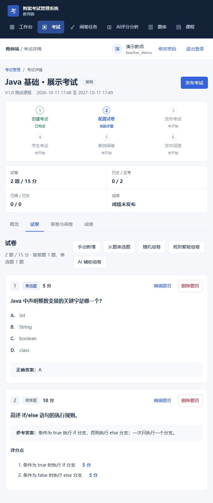
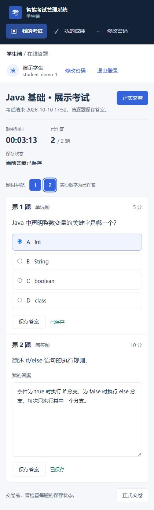
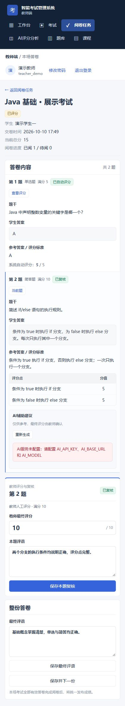
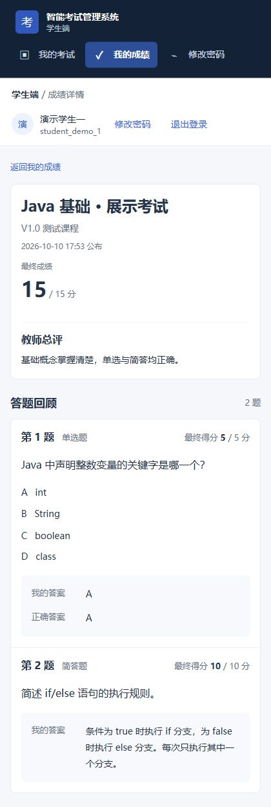
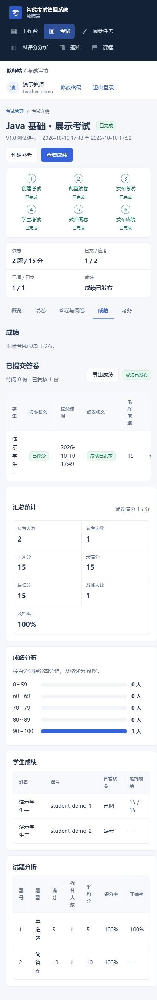
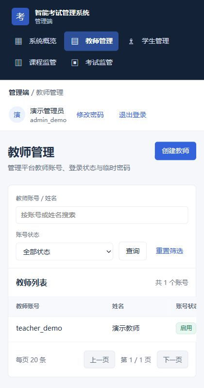
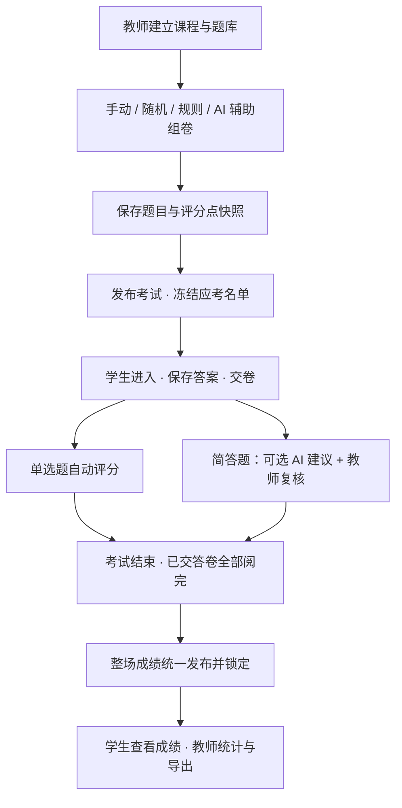
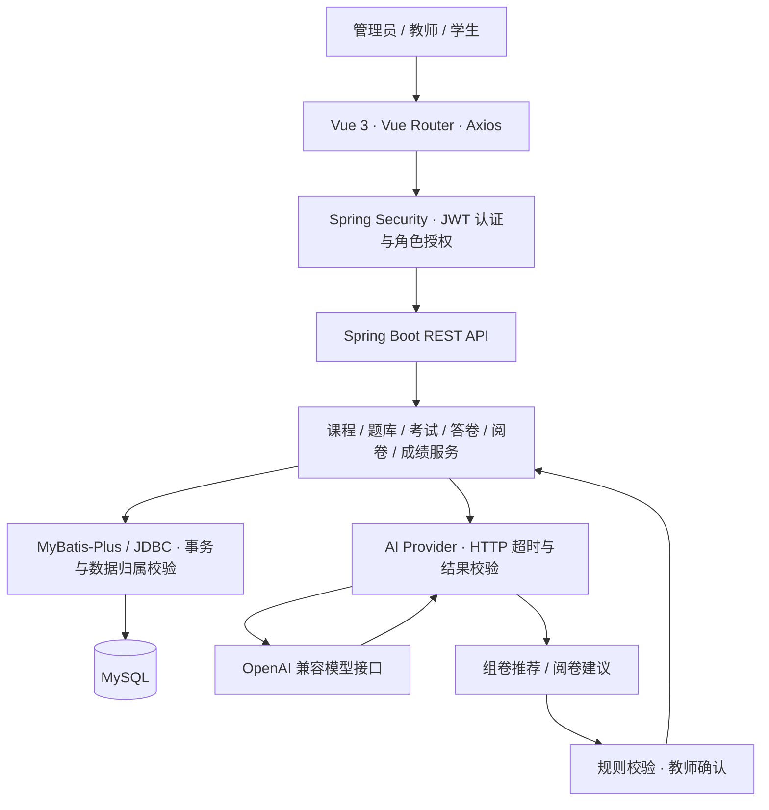

# 智能考试管理系统

**Smart Exam Management System · Spring Boot + Vue 3 + AI 辅助组卷与阅卷**

面向管理员、教师和学生的考试业务系统，串联**课程与题库 → 组卷 → 发布 → 在线作答 → 教师阅卷 → 成绩发布与分析**。目前支持单选题和简答题，AI 用于理解组卷需求、提供简答题评分建议，最终题目选择受后端规则约束，主观题成绩由教师确认。

[界面展示](#界面展示) · [业务流程](#业务流程) · [AI 如何参与业务](#ai-如何参与业务) · [技术设计](#技术设计) · [本地运行](#本地运行) · [验证与项目边界](#验证与项目边界)

本仓库提供完整前后端源码、数据库初始化与 Demo 数据、本地启动脚本及测试，当前发布版本为 [v1.0.1](https://github.com/futuredream-dev/smart-exam-system/releases/tag/v1.0.1)。可按下方步骤本地运行；当前没有对外部署的在线演示地址。

## 项目亮点

- **完整考试闭环**：教师配置试卷和应考名单，学生保存答案并交卷，系统自动评分单选题，教师复核简答题，考试结束后统一发布成绩。
- **AI 接入实际业务**：自然语言组卷经过意图解析、题库匹配、候选诊断和规则校验；阅卷建议包含分数、理由、命中与遗漏评分点，保留人工复核入口。
- **历史数据稳定**：组卷保存题目与评分点快照，发布冻结应考名单；之后修改题库或课程成员不会改变已发布考试。
- **角色与数据隔离**：管理员、教师、学生分别授权；教师只操作所属课程数据，学生只访问自己的答卷与已发布成绩。
- **考务与后续处理**：提供阅卷任务、作答进度和行为记录、成绩统计、Excel 导出、考试复制、补考关联及归档恢复。

## 界面展示

以下为 **2026-10-10、v1.0.1 源码的实际运行截图**，使用独立演示库和公开 Demo 账号。展示考试通过业务接口创建、发布，并在实际页面完成作答与人工复核；自然结束后统一发布成绩。本次补拍未启用模型服务，阅卷图展示 AI 未配置时的人工处理流程；已有真实 AI 调用记录见[最终验收文档](docs/05_V1.0最终验收报告.md)。

| 教师：试卷配置与组卷入口 | 学生：在线答题与保存状态 |
|---|---|
|  |  |

| 教师：简答题人工复核 | 学生：已发布成绩与答题回顾 |
|---|---|
|  |  |

展开查看成绩统计与管理员账号管理

**教师成绩中心**：查看已交、已阅、缺考及成绩发布状态，统计总分和题目表现，导出成绩 Excel。

**管理员教师管理**：查询教师账号与启用状态，提供创建账号、启停用和重置密码入口。

## 业务流程

成绩发布以整场考试为单位：须等待考试结束、处理到时自动交卷，并完成所有已交答卷的阅卷。缺考学生不阻塞发布；发布后不能再修改教师评分、评语或重新请求 AI 评分。

## 核心功能

| 角色 | 已实现功能 |
|---|---|
| 管理员 | 系统概览；教师账号管理；学生、课程与考试管理和监管 |
| 教师：教学准备 | 课程与学生管理、学生 Excel 批量导入；题库、章节、知识点、标签和难度管理；题目 Excel 导入预览、确认与重复处理 |
| 教师：考试组织 | 手动选题、随机组卷、规则智能组卷、AI 辅助组卷；候选不足诊断；发布前检查；应考名单与考务进度 |
| 教师：阅卷与成绩 | 阅卷任务筛选；客观题自动分、AI 建议与人工最终分；整场成绩发布；总分与题目分析；AI 评分偏差分析；11 列成绩 Excel 导出 |
| 教师：后续考务 | 复制为独立草稿、创建关联补考并选择补考学生、归档与恢复考试 |
| 学生 | 注册与登录；考试安排与入场限制；倒计时、题目导航、逐题保存、重新进入恢复已保存答案；交卷；查看已发布成绩与答题回顾 |

## AI 如何参与业务

### 1. AI 辅助组卷：把自然语言转换为可检查的题库条件

例如，教师可以描述“选择 Java 控制流相关题目，包含简单单选题和中等简答题”。模型解析题型、数量、难度及主题等意图，应用将元数据映射到本地题库，诊断候选数量，再生成推荐与试卷预览，最后由教师确认加入。

后端负责校验题数、题型、分值、READY 状态、题目归属、重复题等硬约束；候选不足时返回缺口，避免生成半成品。模型不生成新题，也不能绕过权限或修改已发布试卷。未配置模型服务时，可继续使用手动、随机和规则组卷。

实现入口：[AiAssemblyService](backend/src/main/java/com/smartexam/service/AiAssemblyService.java)、[RuleAssemblyService](backend/src/main/java/com/smartexam/service/RuleAssemblyService.java)。

### 2. AI 辅助阅卷：建议可解释，教师确认最终分

| 环节 | 具体处理 |
|---|---|
| 输入 | 试题快照、参考答案、评分点与学生答案 |
| 模型输出 | `aiScore`、`aiReason`、`matchedPoints`、`missingPoints`、`aiComment` |
| 应用校验 | 建议分限制在 0 至题目满分，按结构解析后保存 AI 结果 |
| 教师复核 | 查看建议与评分参考，填写 `teacherScore` 和评语，系统重新汇总总分 |
| 失败兜底 | 未配置标记 `NOT_CONFIGURED`；请求或解析失败标记 `FAILED`，清除失效建议，仍可人工阅卷 |

AI 建议和教师最终分分别保存，AI 请求不会自动把建议分计入最终成绩。实现入口：[AiGradingService](backend/src/main/java/com/smartexam/service/AiGradingService.java)、[TeacherGradingService](backend/src/main/java/com/smartexam/service/TeacherGradingService.java)。

### 3. AI 评分分析：比较建议分与人工分

分析页只纳入 **AI 成功返回建议且教师已复核的简答题样本**，按考试和题目统计样本数、AI / 教师均分、MAE、Bias 及分差区间，并可查看样本详情。

- MAE：`平均值(|AI 建议分 − 教师最终分|)`，衡量平均偏差大小。
- Bias：`平均值(AI 建议分 − 教师最终分)`，观察偏高或偏低趋势。

这些指标描述当前样本与教师评分的差异，不代表普遍的模型准确率。实现入口：[AiEvaluationService](backend/src/main/java/com/smartexam/service/AiEvaluationService.java)。

## 技术设计

| 设计点 | 解决的问题与实现方式 |
|---|---|
| 题目与评分点快照 | 从题库入卷时复制内容、参考答案和评分点；后续题库编辑不影响旧试卷与评分依据 |
| 应考名单快照 | 发布时写入 `exam_candidates`；考试资格依据名单判定，课程后续增减学生不改变已发布名单 |
| 答卷状态与并发保护 | 后端检查入场、迟到、最早交卷及截止时间；保存、交卷与成绩发布采用事务和相关行锁，交卷后拒绝继续改答案 |
| 统一成绩发布 | 以 `results_released_at` 记录整场发布；学生仅查询自己的已发布成绩，发布后锁定评分和评语 |
| 角色与字段隔离 | Spring Security 限制角色，业务服务再检查资源归属；学生答题响应不包含参考答案、评分点或 AI 内部结果 |
| AI 可用性兜底 | 未配置、请求失败或返回异常均保留人工路径；失效 AI 建议不混入教师最终分 |
| 考务记录 | 记录切出页面、离开页面和重新进入等事件，展示学生作答进度；行为事件仅供教师参考，不自动判定作弊 |
| 复制、补考与归档 | 复制和补考创建独立考试与试题，不继承答卷或成绩；归档使用 `archived_at`，保留历史数据与学生成绩访问 |

关键服务：[TeacherManagementService](backend/src/main/java/com/smartexam/service/TeacherManagementService.java)、[StudentExamService](backend/src/main/java/com/smartexam/service/StudentExamService.java)、[ExamMonitorService](backend/src/main/java/com/smartexam/service/ExamMonitorService.java)。

## 技术栈

| 部分 | 当前项目使用 |
|---|---|
| 后端 | Java 17、Spring Boot 3.4.5、Spring Security、JWT、MyBatis-Plus 3.5.12、Apache POI 5.4.1 |
| 前端 | Vue 3.5.13、Vue Router 4.5.0、Axios 1.7.9、Vite 6.1.0 |
| 数据库 | MySQL 8.0.16 及以上 |
| AI 接口 | OpenAI 兼容的 HTTP Provider，通过环境变量配置地址、密钥与模型 |
| 构建与本地开发 | Maven、pnpm、PowerShell 开发脚本 |

版本来自 [后端依赖](backend/pom.xml)、[前端依赖](frontend/package.json) 和 SQL 约束。Node.js 20 及以上是本地启动脚本的检查要求；pnpm 需要可执行，项目未锁定其全局版本。AI 地址、密钥与模型均通过环境变量配置。

## 项目结构

~~~text
backend/     Spring Boot API、业务服务与测试
frontend/    Vue 页面、路由与构建配置
sql/         全新建库、Demo 数据与历史升级脚本
scripts/     Windows 本地启动、检查、停止及 Maven 准备
config/      本地环境变量模板
docs/        运行说明、验收记录、界面截图与历史文档
~~~

## 本地运行

以下命令在 Windows PowerShell 的**项目根目录**执行。其他系统可分别启动后端和前端，但本仓库的一键脚本面向 Windows。

### 1. 准备环境

安装并启动 MySQL 8.0.16 及以上；安装 JDK 17、Node.js 20 及以上和 pnpm，并确保 java、node、pnpm 在 PATH 中。启动脚本优先使用 PATH 或 MAVEN_HOME 中的 Maven；若没有，会下载并校验 Maven 3.9.9，首次下载需要网络。

### 2. 初始化数据库

使用有建库权限的 MySQL 账号，在项目根目录进入 MySQL 命令行：

~~~powershell
mysql -u root -p --default-character-set=utf8mb4
~~~

在 MySQL 提示符依次运行：

~~~sql
SOURCE sql/init.sql;
SOURCE sql/demo-data.sql;
~~~

[init.sql](sql/init.sql) 创建 smart_exam 库与当前 19 张表，只用于**全新环境**。[demo-data.sql](sql/demo-data.sql) 加入稳定账号、课程、题库、题目和已发布考试；可在演示库重复运行，不会持续创建重复数据，也不会重置已有答卷和考试状态。已有业务库不要运行演示数据脚本。历史库升级注意事项见[数据库说明](sql/README_数据库共享说明.md)。

### 3. 配置本地环境

首次使用时复制模板；已有 config/local.env 时不要覆盖：

~~~powershell
Copy-Item config/local.env.example config/local.env
~~~

编辑被 Git 忽略的 config/local.env，至少填写本机的 DB_PASSWORD 和自行生成的高熵 JWT_SECRET（至少 32 字符）。模板已有 DB_HOST、DB_PORT、DB_NAME、DB_USERNAME 的本机默认值；需要使用其他连接参数时修改对应字段。开发脚本读取该文件，已有进程环境变量优先。不要提交真实密码、密钥或访问令牌。

AI_BASE_URL、AI_API_KEY、AI_MODEL 三项均填写后启用 AI 辅助能力；不填写时仍可使用规则组卷与人工阅卷。ADMIN_USERNAME、ADMIN_INITIAL_PASSWORD、ADMIN_NAME 只供空库首次创建管理员；使用上述 Demo 数据时无需填写。其他可选变量见[后端配置](backend/src/main/resources/application.yml)。

### 4. 启动、检查和停止

~~~powershell
.\scripts\dev.ps1 -Action start
.\scripts\dev.ps1 -Action check
.\scripts\dev.ps1 -Action stop
~~~

三条命令按需分别执行，不要连续运行。start 会检查环境和端口、准备 Maven、打包后端、在前端依赖缺失时按锁文件安装依赖，并等待服务就绪；不希望自动打开浏览器时加 -NoBrowser。检查与停止只针对本项目脚本管理的服务。

| 地址 | 用途 |
|---|---|
| http://localhost:5173/login | 前端登录页 |
| http://localhost:8080 | 后端服务，API 路径以 /api 开头 |
| http://localhost:8080/actuator/health | 后端与数据库健康状态 |

脚本固定检查后端 8080、前端 5173 和本机 MySQL 3306；端口被其他进程占用时先处理占用。更详细的排查见[本地运行说明](docs/04_部署与运行说明.md)。

## Demo 账号

| 角色 | 用户名 | 密码 |
|---|---|---|
| ADMIN | admin_demo | password |
| TEACHER | teacher_demo | password |
| STUDENT | student_demo_1 | password |
| 备用学生 | student_demo_2 | password |

这些公开凭据仅用于本地开发和受控演示，请勿用于生产环境。全新演示库还包含一门课程、一个题库、七道可用题和一场已发布且尚无答卷的考试；考试开放期从首次导入起一年。

## 快速演示

1. 用管理员账号查看教师、学生、课程和考试。
2. 用教师账号查看课程与题库；另建草稿考试或复制 Demo 试卷，设置近期开始、几分钟后结束的短时场次，最早交卷设为 0，迟到限制覆盖作答演示所需时间。在开始前完成组卷与发布。
3. 用学生账号进入这场已发布的短时考试，逐题保存答案并交卷。重新进入时会恢复已保存答案；交卷后不能继续修改。
4. 返回教师账号查看答卷和客观题得分，对简答题获取可选 AI 建议并人工复核、保存评分和总评。等待考试自然结束、已交答卷全部阅完，再统一发布成绩。
5. 用学生账号查看成绩和答题回顾；教师可查看考试统计并导出成绩。

初始化的“Demo 入门考试”默认开放一年，适合直接体验答题；要在几分钟内演示到成绩发布，请使用上面的短时场次。演示数据会随操作改变。需要全新起点时，在**新的空库**重新执行两步初始化，不要用 init.sql 覆盖现有业务库。

## 开发与验证命令

脚本启动是推荐路径。单独开发时，先在当前终端设置 DB_*、JWT_SECRET 等环境变量；手工启动不会自动读取 config/local.env：

~~~powershell
$maven = .\scripts\ensure-maven.ps1
& $maven -f backend/pom.xml spring-boot:run
~~~

另开一个终端：

~~~powershell
Push-Location frontend
pnpm install --frozen-lockfile
pnpm dev
Pop-Location
~~~

后端测试与打包：集成测试需要可用 MySQL。先按 `init.sql` 初始化专用测试库，并将当前终端的 `DB_NAME` 指向该库、配置连接参数及 `JWT_SECRET`；请勿连接已有业务库。

~~~powershell
$maven = .\scripts\ensure-maven.ps1
& $maven -f backend/pom.xml package
~~~

前端状态逻辑测试与构建：

~~~powershell
Push-Location frontend
node --test tests/*.test.mjs
pnpm build
Pop-Location
~~~

## 验证与项目边界

2026-10-10 公开发布前，对 v1.0.1 源码执行的验证结果：

| 验证 | 结果 | 范围 |
|---|---|---|
| 后端 Maven `package` | **349 个测试通过，0 失败 / 错误 / 跳过** | 认证、数据隔离、快照、组卷、答卷、阅卷、成绩、考务、复制归档等自动化测试及打包 |
| 前端 `node --test tests/*.test.mjs` | **24 个测试通过，0 失败** | 组卷、题库导入与元数据、阅卷状态和考务等逻辑 |
| 前端 `pnpm build` | **成功** | Vite 生产构建；存在不阻塞构建的动态 / 静态混合导入提示 |

测试源码见[后端测试](backend/src/test/java/com/smartexam)与[前端测试](frontend/tests)。另有 [2026-10-07 最终验收记录](docs/05_V1.0最终验收报告.md)，记录独立库的浏览器业务闭环、权限隔离、真实 AI 调用及结果核对；应结合报告日期与环境理解，自动化测试通过不等于所有浏览器路径或任意模型效果都已验证。

本项目用于学习、业务实践与求职展示，开发过程中使用 AI 编程工具辅助。当前题型限于单选和简答；未实现独立管理员操作日志或自动作弊判定，也没有本次公开发布的线上部署、生产压测与大规模用户运行证据。模型效果随服务、模型及评分点变化，最终成绩仍以教师复核为准。

真实环境配置、密码、密钥和令牌保存在被 Git 忽略的本地文件中；仓库只提供配置模板和公开 Demo 凭据。运行或部署时请使用自己的独立配置。

## 文档导航

| 文档 | 内容 |
|---|---|
| [部署与运行说明](docs/04_部署与运行说明.md) | 环境要求、启动脚本、配置、端口与常见问题 |
| [数据库共享说明](sql/README_数据库共享说明.md) | 全新建库、Demo 数据与历史库升级边界 |
| [V1.0 最终验收记录](docs/05_V1.0最终验收报告.md) | 已记录的独立环境、操作结果和已知非阻塞项 |
| [题库来源说明](docs/phase3/题库数据来源说明.md) | 另行整理题库的来源、改编与发布边界；相关本地 Excel / CSV 尚未纳入公开仓库 |
| [历史资料索引](docs/archive/README.md) | 早期设计与阶段记录；当前运行方式以本 README 和运行说明为准 |

历史迁移脚本保留在 `sql/upgrade_*.sql`；全新数据库不需要执行升级脚本。
