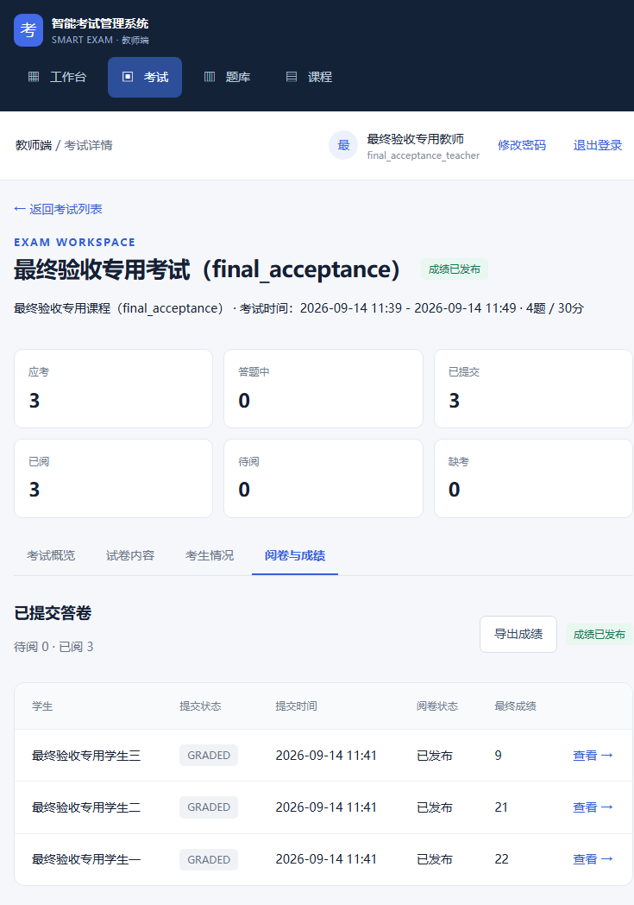
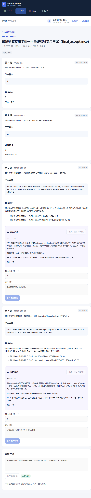
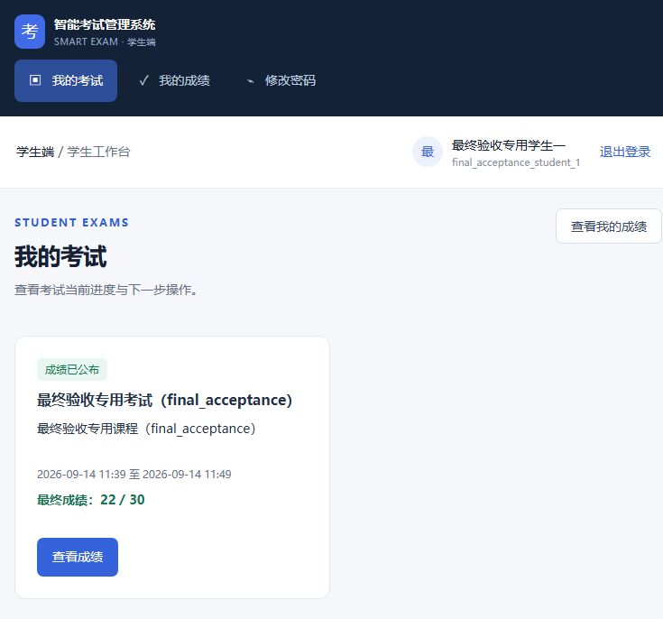
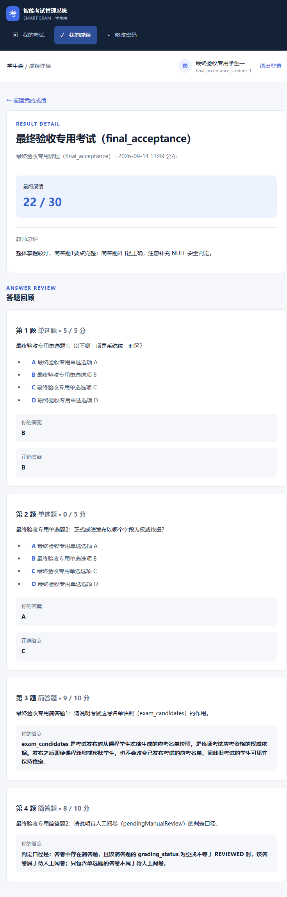
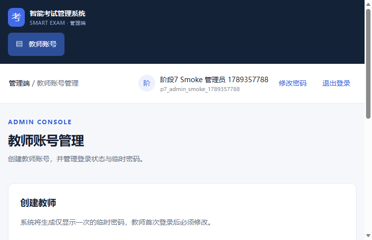
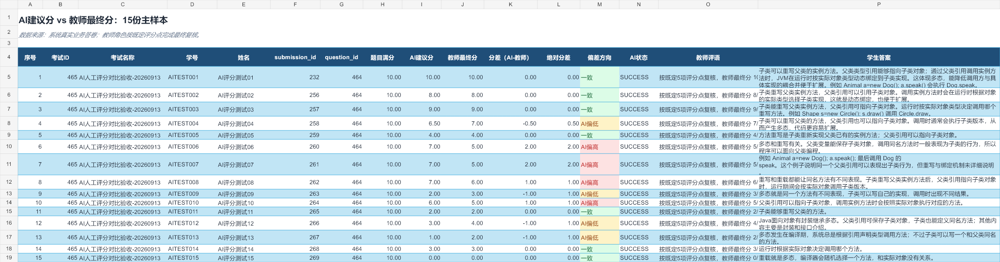
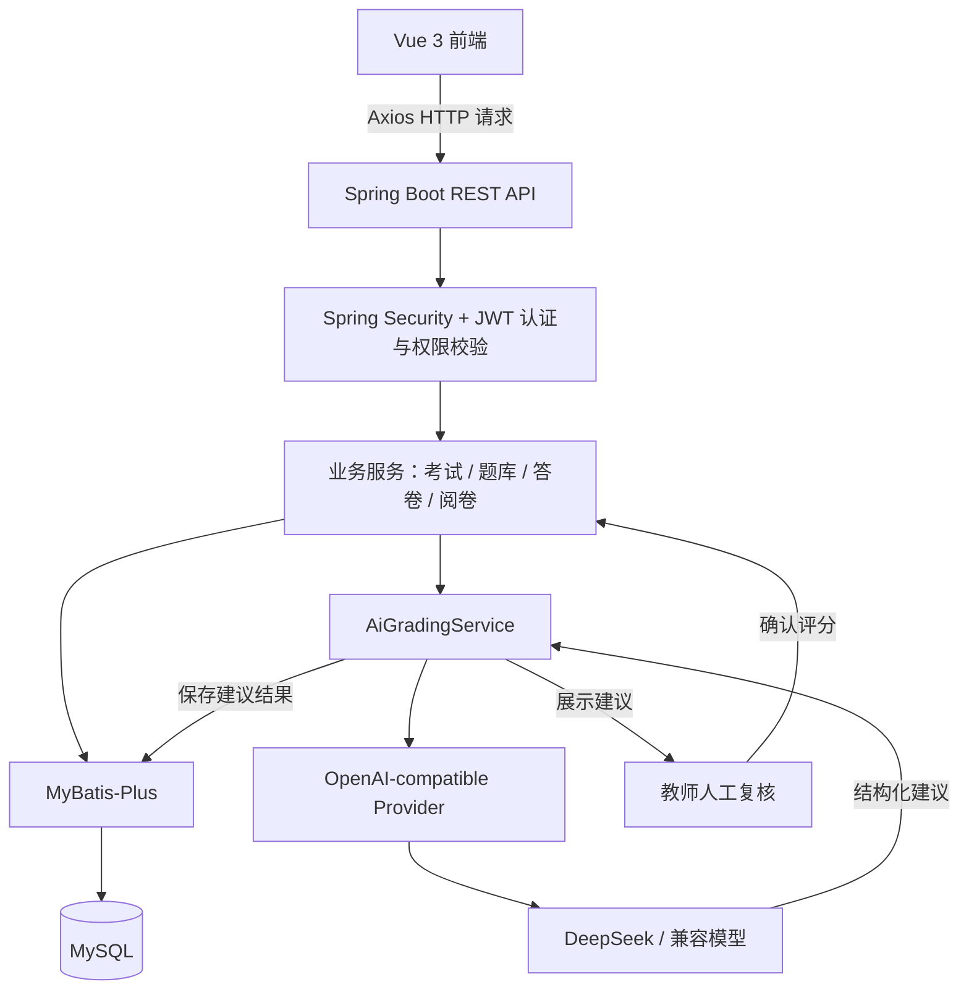
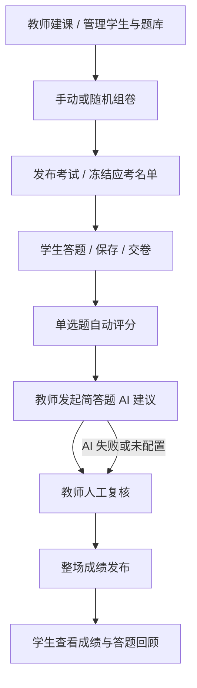

# 智能考试管理系统

> 面向教学场景的 AI 辅助阅卷与考试管理平台

**Current Version: V1.0 Release Candidate · 验收通过，准备首次 GitHub 发布**

## 项目简介

项目按真实考试业务流程设计，覆盖课程与学生管理、题库、组卷、发布、答题、AI 辅助阅卷、教师复核、成绩发布与学生回顾。当前支持单选题和简答题，提供管理员、教师、学生三个角色的独立工作空间。

AI 根据参考答案和评分点生成结构化建议，教师拥有简答题的最终评分权。AI 建议与人工评分分别存储；模型超时、服务异常或返回格式错误时，仍可完成人工阅卷和成绩发布。

## 核心亮点

- **结构化 AI 建议**：OpenAI-compatible Provider 支持 DeepSeek 接入，返回建议分、评分理由、命中与缺失评分点、评语；建议分限定在 0～题目满分。
- **AI 故障降级**：Provider 异常持久化为 `FAILED`，清除失效建议，不阻断人工复核和后续发布。
- **完整考试规则**：首次进入、重入、保存答案、迟到限制、最早交卷、到期自动提交和已交卷锁定均由后端校验。
- **双重快照隔离**：发布时冻结应考名单；组卷时复制试题与评分点，隔离课程成员和源题库的后续变化。
- **整场成绩发布**：实际答卷全部完成阅卷后统一发布，拒绝重复发布，发布后锁定评分与评语，支持 XLSX 导出。
- **权限与数据隔离**：三角色认证、教师资源归属校验、公共题库只读使用；学生 API 隐藏 AI 内部建议、评分点和未发布成绩。
- **可验证的工程实践**：SQL 升级脚本、单元与集成测试、API 黄金路径、浏览器回归、Windows 一键启停及数据库健康检查。

## 项目截图

以下为本系统正式验收截图，账号、答案和成绩均属于演示或测试数据。

### 教师：考试工作区与阅卷

在一场考试内查看考生情况、阅卷进度、成绩发布状态和导出入口。



<details>
<summary>查看完整答卷：AI 建议与教师评分分别展示</summary>



</details>

### 学生：考试与成绩回顾

学生从考试列表进入考试或已发布成绩；成绩详情包含本人答案、逐题得分与教师总评。



<details>
<summary>查看成绩详情与答题回顾</summary>



</details>

### 管理员：教师账号管理



### AI 建议分与教师最终分

15 份测试样本的人工整理对照，用于观察建议分与最终分的差异；不是线上统计看板，也不代表模型准确率评测。



## 系统架构



模型不直接访问数据库，也不决定最终成绩；建议结果由应用服务校验和持久化。

## 核心业务流程



AI 为可选辅助步骤。单选题按标准答案自动评分，简答题由教师确认，最终总分由后端汇总。

## 技术栈

| 层级 | 技术 |
|---|---|
| 后端 | Java 17、Spring Boot 3.4.5、Spring MVC、Validation |
| 安全 | Spring Security、JWT（JJWT 0.12.6）、BCrypt |
| 数据访问 | MyBatis-Plus 3.5.12、MySQL |
| 前端 | Vue 3.5.13、Vite 6.1.0、Vue Router 4.5.0、Axios 1.7.9 |
| AI | OpenAI-compatible Chat Completions API / DeepSeek |
| Excel | Apache POI 5.4.1，学生导入与成绩导出 |
| 测试 | JUnit、Spring Boot Test、MockMvc、浏览器回归脚本 |
| 开发与运行 | Maven、pnpm、PowerShell、Spring Boot Actuator |
| 部署结构 | Docker Compose、Nginx；配置已提供，真实部署验收待完成 |

## 角色与功能

| 角色 | 主要功能 |
|---|---|
| ADMIN | 创建教师账号、启用/停用、重置临时密码；首次登录强制改密 |
| TEACHER | 课程与学生管理、Excel 导入、个人题库、PLATFORM 公共题库只读使用、手动/随机组卷、考试发布、AI 建议、人工复核、整场成绩发布、XLSX 导出 |
| STUDENT | 注册/登录、考试列表、进入与重入、保存答案、交卷、成绩查看、答题回顾 |

## AI 辅助阅卷设计

```text
学生简答答案 + 试题快照 + 参考答案 + 评分点
    → AiGradingService → AiGradingProvider → LLM
    → 结构化建议 → 校验 / 分数边界保护 → ai_grading_results
    → 教师查看与人工复核 → answers.teacher_score
```

结构化结果包含 `aiScore`、`aiReason`、`matchedPoints`、`missingPoints`、`aiComment`。服务层将越界建议分截断至合法范围；AI 只写建议记录，不直接写入 `teacher_score`。

| 场景 | 持久化状态 | 后续处理 |
|---|---|---|
| 正常返回 | `SUCCESS` | 教师参考建议，独立确认评分 |
| 超时、Provider 异常或无效结果 | `FAILED` | 清空本次失效建议，记录错误，继续人工评分 |
| 未配置 AI | `NOT_CONFIGURED` | 使用人工阅卷流程 |

教师完成简答题复核后，后端以单选题 `auto_score` 与简答题 `teacher_score` 汇总总分。AI 建议分不会参与最终总分计算。

实现入口：[AiGradingService](backend/src/main/java/com/smartexam/service/AiGradingService.java)、[Provider](backend/src/main/java/com/smartexam/service/ai/OpenAiCompatibleGradingProvider.java)、[TeacherGradingService](backend/src/main/java/com/smartexam/service/TeacherGradingService.java)。

## 关键业务设计

### 考试名单快照

发布考试时生成 `exam_candidates`。后续课程新增学生不会获得旧考试资格，移除课程成员也不会改变已经冻结的名单。

### 试题与评分点快照

题库是组卷来源。组卷后复制题干、选项、答案、分值及评分点；源题目编辑或归档不会污染既有考试。AI 阅卷读取考试快照中的参考答案和评分点。

### 成绩发布锁

以 `exams.results_released_at` 记录整场发布时间。发布前检查实际答卷已完成阅卷，缺考学生不阻塞发布；发布后拒绝改分、AI 重评、评语修改和重复发布，学生此时才可查看成绩。

### AI 与人工评分隔离

`ai_score` 与 `teacher_score` 是独立字段，不存在自动覆盖关系。建议失败不会删除教师评分；简答题最终成绩以教师确认结果为准。

## 安全设计

- JWT 无状态认证，密码使用 BCrypt 哈希，覆盖 ADMIN / TEACHER / STUDENT 权限及首次改密流程。
- 教师接口检查课程、考试、答卷与题库的资源归属；PLATFORM 题库允许教师只读使用，禁止越权修改。
- 学生接口不返回 AI 建议、内部错误或评分点；未发布成绩不可见。发布后的单选题回顾可显示正确选项。
- 数据库密码、JWT 签名密钥、管理员初始密码和 AI 凭据通过环境变量提供；`config/local.env` 已被 `.gitignore` 排除。
- 初始化脚本含公开演示账号，仅用于受控开发环境；对外部署前应删除或重置演示账号。

## 测试与质量

以下为 V1.0 RC 已完成的验收基线，不是本次文档修改重新运行的结果，也不是持续集成状态。

| 验证层次 | 已记录结果 |
|---|---|
| 后端 Unit / Integration | 28 个测试类，175 tests / 0 failures / 0 errors / 0 skipped |
| API 黄金路径 | 66 assertions / 0 FAIL |
| 前端构建 | 117 modules / build PASS |
| Browser smoke / 监控 | 0 HTTP 500 / 0 Vue runtime error |

后端与构建结果、专项边界和浏览器验收说明见[正式验收记录](%E3%80%8A%E9%87%8D%E6%9E%84%E9%AA%8C%E6%94%B6%E8%AE%B0%E5%BD%95.md%E3%80%8B)；黄金路径及浏览器零错误计数采用 V1.0 RC 汇总验收口径。重点覆盖 AI 断线降级、建议分越界、快照隔离、成绩发布锁和跨角色访问。

后端集成测试连接真实 MySQL，需要准备独立测试数据库和环境变量。`frontend/scripts/` 保留专项回归脚本；历史验收用的部分临时脚本与原始日志不随仓库发布，不能将这些数字理解为一次命令即可全部复现。

## 快速开始

### 环境要求

- Java 17、MySQL 8.0.16+（8.x）、Node.js 20+、pnpm。
- Maven 3.9+ 可选预装；`scripts/ensure-maven.ps1` 可下载 Maven 3.9.9、校验 SHA-512 并缓存到项目忽略目录，首次准备需联网。
- 以下命令在 Windows PowerShell 的项目根目录执行。业务时区为 `Asia/Shanghai`，数据库字符集为 `utf8mb4`。

### 1. 初始化数据库

启动 MySQL，用具备建库和建表权限的账号打开客户端：

```powershell
mysql -u root -p --default-character-set=utf8mb4
```

在 MySQL 客户端中执行：

```sql
SOURCE sql/init.sql;
```

首次初始化会创建 `smart_exam`、当前表结构及必要演示 seed；不依赖作者电脑的数据。日常启动无需重复初始化，截图中的验收考试与 AI 测试样本不会自动导入。

### 2. 填写本地配置

首次配置时复制示例文件；已有本地配置时不要覆盖：

```powershell
Copy-Item config/local.env.example config/local.env
```

在编辑器中填写配置，勿提交真实值。JWT 签名密钥应使用至少 32 字符的高熵随机值。需要初始管理员时填写全部三个 `ADMIN_*` 字段；仅在数据库尚无 ADMIN 且配置完整时创建，首次登录要求改密。

### 3. 启动、检查与停止

```powershell
.\scripts\dev.ps1 -Action start
```

启动脚本读取 `config/local.env`，已有进程环境变量优先；检查 MySQL、准备 Maven、打包后端并启动前端。前端依赖缺失时执行锁文件安装，等待数据库健康与前端就绪后打开 [登录页](http://localhost:5173/login)。

```powershell
.\scripts\dev.ps1 -Action check
.\scripts\dev.ps1 -Action stop
```

`check` 查看状态，`stop` 停止本项目服务，按需单独执行。也可使用根目录 `start-dev.bat`、`check-env.bat`、`stop-dev.bat`。端口约定为后端 8080、前端 5173；启动脚本不会通过换端口绕过占用。

## 环境变量

[config/local.env.example](config/local.env.example) 当前包含以下字段，表中仅列用途，不提供凭据值：

| 变量 | 用途 |
|---|---|
| `DB_PASSWORD` | 本地数据库连接密码 |
| `JWT_SECRET` | JWT 签名密钥，必填，无默认密钥 |
| `ADMIN_USERNAME` | 首个管理员登录名 |
| `ADMIN_INITIAL_PASSWORD` | 首个管理员初始密码 |
| `ADMIN_NAME` | 首个管理员显示名称 |

以下可选变量由 [application.yml](backend/src/main/resources/application.yml) 支持，尚未列入上述 example。需要时可通过进程环境变量提供，或补入本地 `config/local.env`：

| 变量 | 用途 |
|---|---|
| `DB_HOST` / `DB_PORT` / `DB_NAME` / `DB_USERNAME` | 数据库主机、端口、库名和账号 |
| `AI_BASE_URL` / `AI_API_KEY` / `AI_MODEL` | 兼容模型服务地址、访问凭据和模型；三者配置完整时启用 AI |
| `AI_TIMEOUT_SECONDS` | AI 请求超时 |
| `JWT_EXPIRATION` | 登录令牌有效期 |
| `SERVER_PORT` / `CORS_ALLOWED_ORIGINS` | 后端端口和跨域来源；一键脚本按固定端口约定运行 |

AI 未配置时仍可使用人工阅卷。根目录 `.env.example` 属于 Docker Compose 配置，与 Windows 开发用 `config/local.env` 分开管理。

## 数据库初始化与 Migration

| 文件 | 用途 |
|---|---|
| `sql/init.sql` | 新数据库的完整结构与必要演示 seed，包含名单快照和题库结构 |
| `sql/smart_exam_team_v1.sql` | 团队初始化脚本，供首次建库参考 |
| `sql/upgrade_t08_2a_exam_candidates.sql` | 增加应考名单快照，并兼容回填历史考试名单 |
| `sql/upgrade_t08_2b_exam_result_release.sql` | 增加整场成绩发布时间并兼容旧发布记录 |
| `sql/upgrade_t08_2c_question_bank_scope.sql` | 增加 TEACHER / PLATFORM 题库作用域与约束 |

升级脚本需先备份、选中目标数据库并核对现有结构，再按适用版本顺序执行；不是自动迁移框架，也不能替代缺失的前置表结构。新库按当前 `init.sql` 初始化即可；不要用初始化 seed 覆盖已有业务账号。

## 项目目录

```text
backend/               Spring Boot API、业务服务与测试
frontend/              Vue 页面、路由、样式与专项回归脚本
sql/                   初始化、演示 seed 与增量升级脚本
scripts/               Windows 启停及 Maven 准备
config/                本地配置示例
gui-test-screenshots/   已归档的正式截图
docs/                  需求与设计资料，部分保留早期阶段口径
```

## 开发与测试命令

后端测试：先在当前 PowerShell 进程配置与测试数据库对应的 `DB_*`、`JWT_SECRET` 环境变量。直接调用 Maven 不会自动读取 `config/local.env`；可在同一终端通过开发脚本加载配置后运行。

```powershell
$maven = .\scripts\ensure-maven.ps1
& $maven -f backend/pom.xml test
```

前端安装与构建：

```powershell
Push-Location frontend
pnpm install --frozen-lockfile
$env:CI = 'true'
pnpm build
Pop-Location
```

前端开发可在 `frontend/` 下运行 `pnpm dev`；统一启停优先使用前述 `dev.ps1`。测试应使用专用数据环境，不能以测试命令替代生产数据备份。

## Docker 状态

仓库包含前后端 Dockerfile、`docker-compose.yml` 与 Nginx 配置，提供 MySQL、后端 API 和前端静态服务的部署结构。

**当前 V1.0 RC 的 Docker 部署尚未完成正式环境验收，因此暂不将其列为已验证发布能力。** 镜像构建、容器启动、Nginx 路由、登录与数据卷持久化仍需实机验收；当前 Compose 也未传入 AI 和管理员初始化变量，完整功能部署需后续补齐验证。

## 项目状态与后续规划

V1.0 Release Candidate 已通过功能验收，正在准备首次 GitHub 发布；尚未创建版本 Tag，许可证待决定。

V2 规划（尚未实现）：AI 阅卷任务中心、AI 与教师评分差异统计、试题/考试数据分析、运行监控、Docker 正式部署验证、CI/CD。

## 项目背景

个人工程实践项目，重点用于验证真实考试业务建模、AI 应用集成、权限安全、测试与工程化能力。
