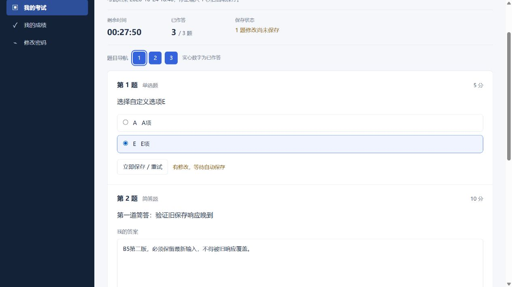
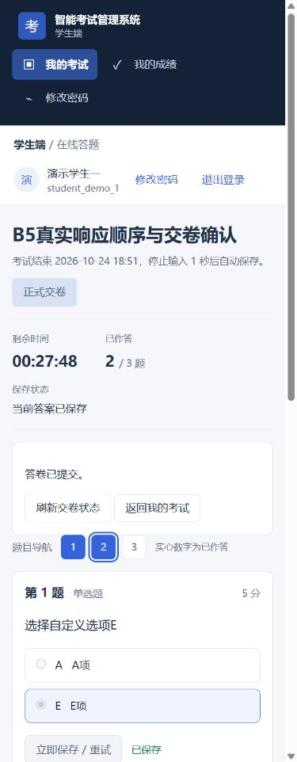

# 系统优化整体验收进度与发布门槛

执行更新：2026-10-25。文件沿用批准计划中的名称，日期不表示10月19日已完成整体验收。10月24日浏览器证据与10月25日重新执行的自动化校验分开记录。

**整体结论：不通过完整发布验收，尚不能作为已通过的发布候选。** B0/B1及B3、B4A的已交付增量可逐批审阅；B2仍有真实浏览器故障矩阵缺口，T17/B5在进行中，B4B业务决策包未实施。没有合并、推送、部署、切换原访问入口或迁移原业务库。

当前基线 `aae50a8`；本报告同批包含交卷回执提示修复、旧逻辑验收入口更新和说明文档。最终提交以Git历史和构建包manifest为准。

## 2026-10-24新增的实际浏览器证据

环境为独立工作区 `codex/system-optimization`，应用 `127.0.0.1:15173 → 18080 → 13306`，库 `smart_exam_opt_test_20261019`，受限专用账号。原项目为 `D:\智能考试管理系统`。

| 编号/场景 | 前置、动作、期望和实际 | 结论/证据 |
| --- | --- | --- |
| F03，旧保存响应晚到 | 合成考试5417/答卷3287，第一题自定义E、两简答。代理把简答第一版成功响应延迟8秒；其间修改为第二版并填写另一题。页面保留第二版，服务器最终保存第二版及另一题；同题PUT两次、另一题一次 | 本场景通过；下方截图、私有代理计数和只读SQL |
| F03/F16，交卷响应超时 | 服务器实际完成POST交卷，代理延迟响应14秒超过客户端10秒；页面只发一次POST，再GET场次状态一次，得到SUBMITTED，禁用继续编辑 | 本场景通过；3287与修复复核3288均实际发生 |
| 新发现：回执矛盾提示 | 3287确认“答卷已提交”后仍保留“结果尚未确认”红色错误。真实编译处理器新增错误清除断言RED，确认终态时清除旧错误；失败状态查询仍保留不确定提示 | 已修复；前端全套148项及实际3288复核无红色错误 |
| F02，选项E | 两份实际答卷选择E并通过页面交卷；只读核对服务器持久化E，客观题评分路径执行 | 此路径通过，不能替代所有组卷方式浏览器回归 |
| F21，旧验收入口 | 管理员结构脚本通过。旧学生脚本因扩展名导入和过时处理器前提不可运行，替换为当前逻辑/真实编译处理器回归入口，保留四项进入/重入成功及拒绝后不导航检查 | 60项通过；不是浏览器E2E |
| 页面宽度 | 当前学生首页1440/1280/768/390，文档宽1425/1265/753/375，无水平溢出；教师本批1280，其他教师宽度见T11历史批次 | 所列页面通过，不称全部页面全状态矩阵完成 |
| 三角色补查 | 教师分页及学生列表见T15；本批管理员实际登录读取概览，访问教师路由回到管理员首页；Tab焦点到系统概览链接并可见 | 所列路径通过；没有重置账号或修改管理员权限 |

故障代理仅绑定loopback18081、固定转发本任务18080，未记录答案、密码、请求头或Token；只对明确合成答卷路径注入延迟。测试后已关闭代理、恢复Vite直连18080，未改后端JWT或原环境。14秒延迟不属于真实浏览器offline开关；不得混称。

## 自动化和构建

- 前端完整 `node --test tests/*.test.mjs`：148通过，失败0、跳过0；Vite生产构建退出0。
- 学生兼容CLI：60项逻辑及编译组件处理器回归通过；管理员结构脚本通过。
- 后端本批完整verify：434/434，失败0、错误0、跳过0，2026-10-24 18:31:32 +08 BUILD SUCCESS。随后目标库检查3个场景通过，退出0。
- 测试环境guard在后端执行前确认实际目标及受限授权。运行日志保留于忽略的 `.runtime/optimization`，不提交含认证请求的完整日志。

## 批次与F项索引

| 范围 | 已交付实现及证据 | 当前边界 |
| --- | --- | --- |
| B0，F22、隔离基线 | `0134e81`，[基线](2026-10-19-execution-baseline.md) | 合成库备份不等于原业务库备份 |
| B1，F01/F02/F04/F07/F08/F09/F18 | `96b83a1`、`7d1d8fd`、`d905b2e`及后续修复，[B1报告](2026-10-20-b1-acceptance.md) | 当日浏览器/Nginx证据，不自动升级为本轮全矩阵 |
| B2，F03/F06/F10/F11/F16 | `971e700`、`1e0c3a4`、`b2c120c`、`56cd161`、`d21f4c8`，[实现](2026-10-20-b2-answer-protection.md)、[浏览器续验](2026-10-23-b2-browser-followup.md) | 主流程及本批两种延迟场景已验，剩余故障项OPEN |
| B3，F12/F13/F14/F15/F17 | `2a3e5ec`、`b59e40f`、`898602c`、`bc084a3`；见对应T10—T13报告 | 保留轻微问题，非所有页面全覆盖 |
| B4A，F05/F16/F17 | `1d10b61`、`aae50a8`，[会话撤销](2026-10-24-b4a-t14-token-revocation.md)、[查询规模](2026-10-24-b4a-t15-query-summaries.md) | 有迁移恢复及当前规模测量，没有生产容量保证 |
| F21 | T11管理员断言及本批学生CLI | 独立CDP/Playwright脚本未运行，不据此称E2E |
| B4B，F19/F20 | 已在设计/计划中拆分权限、身份、审计、成绩纠错 | 未选择或实施；不借优化擅自扩权 |

## 剩余关键验收缺口

以下为未执行，不能勾选通过，也不是已证明的产品缺陷：

1. 浏览器禁止会话存储或真实配额耗尽后的页面；已有存储异常逻辑测试，当前工具没有该环境控制能力。
2. 脏状态硬刷新、关闭标签页原生提醒的完整交互；曾调用reload但未取得可操作的beforeunload对话框，不能当作完成。
3. 客户端墙钟快慢5分钟、真实隐藏/恢复的完整交错；逻辑/处理器有证据，未修改用户系统时间或向页面注入运行时替身。
4. 浏览器offline/online开关及其事件路径、更多保存响应交错；连接拒绝和本批响应延迟分别已验，但未穷尽矩阵。
5. 在最终同一构建中重跑所有手动/Excel/随机/规则/AI组卷、复制补考、归档恢复、导入边界和全部三角色负例的完整浏览器矩阵。现有434项后端回归及各批历史页面证据不替代这项。
6. 全页面四宽度、所有键盘/加载/错误/空态最终覆盖；本批补验主要学生页面，T11/T12有前序教师页面证据，仍不等于全矩阵。

真实模型调用需要单独限定样本与费用，当前未新增调用。可控服务成功/失败/超时由当前后端回归与B1记录分别计证据，不承诺模型质量。

## Deferred minors

- T06：未授权触发到期、非业务异常回滚的显式负例覆盖不足。
- T11：分析加载中清空/选无权考试，加载提示可能持续到有效重选。
- T12：总数0且旧页码大于1时页码/空态文案不够准确。
- T13：无人参考组件测试缺独立判定分支及非空零值桶防回归；多层无人交卷说明仍可精简。
- T14：竞争401先清会话时，迟到改密成功响应可能不显示成功提示；撤销仍有效。
- T15：首次入场事务跨截止时，新列表可能短暂显示过期作答中；后续请求收敛，硬写入截止仍有效。
- T15：普通草稿有效名单与补考专属快照的列表/详情字段一致性直接覆盖不足。
- B5：学生CLI聚合入口移除了旧action/未知状态fallback映射断言，编译入口测试又替换了lifecycleMeta；目前映射正确，但后续按钮被误隐藏可能漏检，需补真实映射与可见性回归。

## Rulings I made

- 用私有、固定上游、按合成答卷限界的代理补验响应延迟；它不能替代浏览器存储、offline开关或系统时钟测试。误把两者等同会放行未验证路径，因此持续保留门槛。
- 将确认回执后残留不确定错误视为影响学生判断的缺陷，补失败断言后只在服务器确认终态时清除；状态查询失败时保留原提示，避免虚报交卷成功。
- 旧学生CLI改为调用当前回归，保留原先服务器授权进入/拒绝导航的实质断言，删除过时文案及不完整依赖替身；代价是CLI为逻辑聚合入口，明确不报告浏览器E2E。
- README测试指导改用受限TEST_DB配置和双层guard；原先“init.sql+DB_NAME”会掩盖固定USE风险，现明确先审查SQL副本而非直接运行原脚本。
- 本报告主动保留“不通过”整体结论。未完成关键矩阵或B4B决策，不能因测试数量增加就宣告全系统完成。

## 发布与回退清单（准备材料，尚未执行）

1. 补齐上列关键验收，固定最终提交、构建哈希、三角色数据和逐场证据；生成明确通过/有条件通过/不通过结论。
2. 在获准切换前单独核对原服务归属、真实目标库结构、原业务备份及实际恢复能力；本轮未读取或备份原业务数据。
3. 确认代码依赖的token_version列，缺列才在已核对连接执行单个增量；已有结构异常则停止该批，不连跑其他脚本。
4. 只准备后端JAR、前端dist、单个迁移及manifest，不包含env、Token、凭据、数据库目录、日志或测试备份；未通过包必须标为待验收。
5. 检查Nginx上传/超时契约及真实部署路径，不能把B1本机代理试验当成目标部署验证。
6. 获得具体切换授权后才备份/迁移/替换原访问入口；本计划批准并非该授权。
7. 切换后的正常及负向冒烟、已发布只读、账号旧JWT拒绝和必要业务数据核对需另有新鲜记录。
8. 回退代码和恢复数据分开执行；保留增量列不等于保留旧会话撤销。旧版无版本校验时须另行安排会话失效或保留安全修复，不能直接删列。
9. 未通过的构建包不得被当成已获准部署的发布物。

## 环境保护

2026-10-24 18:34:38 +08复核：原361/361文件SHA256一致，8处受保护路径元数据一致，原HEAD仍59d1389f31b4931a533390aa684db94dba488e2e，原3306 PID77496；未启停原服务或操作原库。临时故障代理已停止，18081无监听；隔离预览以本批构建重新启动并恢复直连。

整体工作区和验证数据保留供T17续验，未执行破坏性清理。以下阶段归档不表示T17完成。

## 2026-10-25阶段归档

用户允许完成一个阶段后停止汇报。本轮只收尾本增量，没有扩展下一阶段或修改已延期Minor。

### 今日重新执行

| 检查 | 本次实际结果 |
| --- | --- |
| 隔离后端完整verify | 434/434，失败0、错误0、跳过0；13:40:03 +08 BUILD SUCCESS，退出0 |
| 前端全套与生产构建 | 148/148；Vite构建成功，退出0 |
| 学生兼容CLI | 60/60，退出0 |
| 管理员结构脚本 | PASS，退出0 |
| 目标库检查负例/正例 | 3个场景PASS，退出0 |
| 原环境文件与元数据 | 再次361/361 SHA256一致、8处元数据一致，原HEAD不变 |
| 构建预览 | 私有18080健康UP、15173 HTTP200，临时18081无监听 |

私有MySQL仅恢复运行已有数据目录，没有初始化或重灌数据；原3306仍为PID77496。完整日志与当前进程归属位于忽略的运行目录。浏览器截图和代理交错为10月24日证据，今日没有重跑它们，不升级为最终全矩阵通过。

### 本轮独立审查

10月24日派发任务在续接时没有可领取的结果或存活任务，因此10月25日完成一次新的有限增量只读审查；没有就已解决的发现发起二次复审。

结论：无Critical、无Important，1项Minor，已加入上文延期清单。审查者独立执行学生CLI 60/60，并以内存执行真实CLI源码检查退出状态0/1/2/null和spawn失败传播；查看修复后回执截图。其没有修改文件、索引或HEAD，没有执行后端测试或迁移。

**未裁定事项及本轮裁定：**

1. 后端、前端全套和构建：作者今日执行，不能称为双人重复验证。
2. 原361文件、环境元数据、服务与数据库：作者按既有保护脚本复核，审查者未访问原环境；本轮不提供生产数据库操作背书。
3. 延迟8秒/14秒、请求次数和持久化：沿用10月24日作者证据，审查者未独立复现；代理已关闭。
4. 其他截图和全宽度视觉：审查者只检查本修复的回执图，不能宣告所有页面通过。
5. 禁用存储、配额和原生刷新/关闭：保持OPEN，不把组件模拟当作真实环境。
6. 墙钟、隐藏恢复、offline/online和更多交错：逻辑证据与真实浏览器缺口分别保留。
7. 最终同一构建的全部组卷/补考/归档/导入及角色负例：仍未完成，保持完整验收不通过。
8. 原库升级恢复、生产切换、密钥轮换、容量：均未执行，发布及回退清单只是准备材料。
9. 真实AI质量、效果和费用：未新增调用，不给出相应保证。
10. B4B权限、身份、审计、成绩纠错：保持独立业务决策，未扩展实现。
11. T06及T11—T15旧Minor：沿用延期清单，未重开修复。
12. 未知submissionStatus容错：既有终态逻辑未改，没有实际异常响应证据，不把推测列为本批缺陷；未来接口扩展需另验。
13. 今日收尾与审查记录：已补入本节，阶段归档完成仍不等于B5全部完成。

### 归档产物与续接点

本批代码、验证脚本、报告和截图以一个可回退的本地提交归档。另准备仅包含生产JAR、前端dist、单个token_version迁移、报告和哈希manifest的阶段包；包名及manifest绑定最终提交，明确标注 `NOT_PASSED`、无部署授权，不含env、凭据、Token、数据库、测试备份或日志。

下一阶段仅在继续工作时补上文关键浏览器矩阵与业务闭环；当前阶段到此汇报，工作区、隔离库及证据保留。T17仍在进行中，原环境没有切换。
