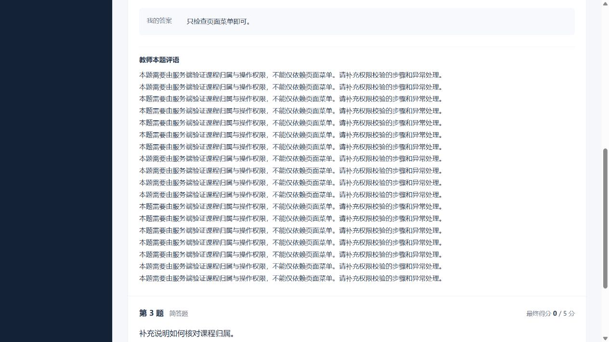
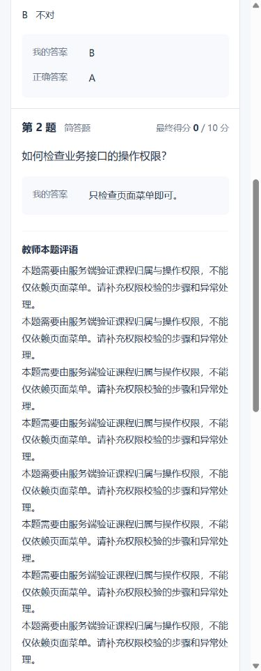
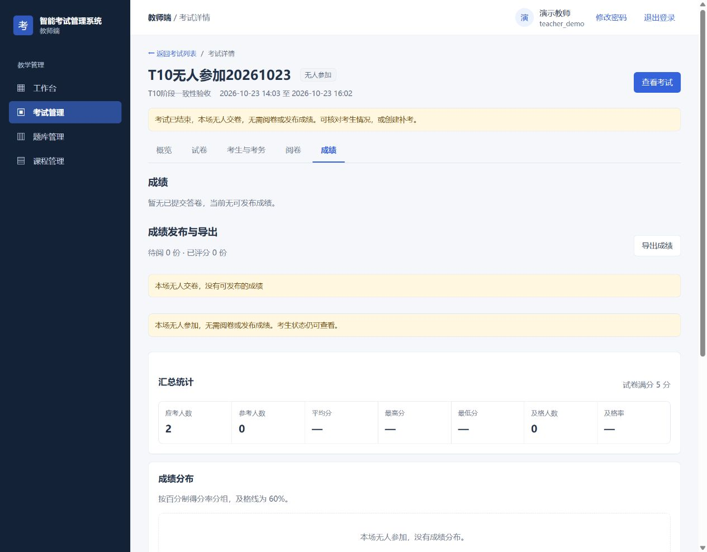

# B3 / T13：已发布成绩的逐题反馈

日期2026-10-24；基线 `898602c`；隔离分支 `codex/system-optimization`。对应同一提交中的实现，不代表整体优化已验收或已部署。

## 交付行为

- 学生已发布成绩详情增加“教师本题评语”，保留换行，长文字自动折行。简答题没有评语时明确提示；零分仍为零，没有总评不影响逐题反馈。
- 后端只扩展当前学生自己的已发布结果投影，仍先检查归属，再检查整场和答卷发布标记：未发布403，他人404。不公开AI内部理由、AI分数、评分点或简答参考答案。
- 教师发布确认说明学生将看到最终得分、本题评语和总评，发布后答卷只读。
- 教师成绩分析接入T10阶段。无人参考时说明无需阅卷或发布，保留应考/缺考名单，分布和试题分析显示空态。
- 保留选择题正确答案公开契约、统一发布、已发布只读及旧接口形状；无依赖升级、无数据库迁移。

## 自动化验证

| 层次 | 实际结果 | 边界 |
| --- | --- | --- |
| 后端新增行为 | 字段缺失2项RED→目标4/4 GREEN | 初次新用例因旧夹具行级已发布标记阻止复核；新夹具从未发布状态开始，实际调用复核、总评及发布接口 |
| 前端新增真实组件渲染 | 4项RED→GREEN | 编译真实Vue组件并以内存渲染器执行；不是浏览器证据 |
| 前端全套 | 139/139，失败0、跳过0 | `node --test tests/*.test.mjs` |
| 前端生产构建 | 成功，退出0 | 现有混合导入提示保留 |
| 后端全套 | 420/420，失败0、错误0、跳过0；verify成功 | 2026-10-24 13:11:08 +08；受限账号/13306测试库；现有MyBatis主键提示保留 |

测试覆盖长评语、零分、无总评、空评语、所有权、双重发布门槛和隐私投影。日志保存在忽略的 `.runtime/optimization/t13-*.log`；全套之后没有修改产品实现。

## 实际浏览器与HTTP

应用 `127.0.0.1:15173 → 18080 → 13306` 均属于隔离工作区。考试4223、答卷2793、课程4927为自建合成数据。夹具只准备未发布结果，**没有伪造成绩发布时间**。

1. 学生一发布前访问结果，显示“成绩尚未统一发布”。
2. 教师实际把待复核题保存为0分，填写18行、846字符本题评语；另一简答题无评语，整份答卷无总评。返回成绩页显示待阅0、已评分1、0/20。
3. 教师实际确认发布；确认文字说明新可见范围，发布后阶段“已完成”，答卷只读。
4. 学生刷新后得到0/20、三题得分及完整长评语；另一简答题有空评语提示，无总评区块。
5. 实际HTTP200结果含逐题 `teacherComment`，没有 `aiReason/aiScore/aiComment/scoringPoints/matchedPoints/missingPoints` 或夹具内部标记；简答 `correctAnswer=null`。忽略的 `t13-http-proof.json` 只存无Token的摘要。
6. 学生二实际登录访问同一地址，显示“成绩不存在”；之后恢复学生一本人结果。
7. 390像素时文档宽375，无水平溢出；评语区约309，`pre-wrap` 与 `overflow-wrap:anywhere` 生效，截图复核正常。
8. 真实无人参考考试2450显示参考人数0、分布桶0个、发布按钮0个，只保留考生名单这一张表。后端仍返回零值分布/题目分析，页面按无人参考状态隐藏，没有制造发布或完成。

## 一次独立审查

全新上下文审查者检查差异并独立执行新增前端4项测试：无Critical、无Important，1项Minor；没有二次审查。

**Deferred minors：** 无人参考组件测试同时满足阶段与计数回落条件，数组为空，没有分别保护两条判定路径及非空零值桶隐藏。真实浏览器已补验后者，但单测仍有空缺，按规则延期。既有T11 AI空选择加载提示、T12空结果页码/文案Minor延续。本页多层无人交卷说明仍可在整体视觉回归中合并，当前不影响发布门槛或数据。

**Rulings I made：**

- 增加 `ExamDetailView` 阶段属性传递和真实组件渲染测试，属于批准的教师成绩一致性所必需；判断错误的影响限于分析显示，全套和实际页面已检查。
- 只开放本题评语，简答参考答案和评分点继续私有，选择题正确答案沿用原契约；未来公开策略需另行决定。
- 新夹具从未发布状态通过真实接口发布，避免旧测试行级标记干扰；代价是测试准备增加，换取生命周期证据。

**审查者未裁定事项及本轮裁定：**

- 后端全套、构建、HTTP、浏览器由作者执行，不能写成双人重复验收。
- 迁移、容量、部署、整体故障矩阵未检验；本批无迁移，其他保留后续门槛，不外推生产表现。
- B2旧响应及跨用户队列没有改动，完整故障矩阵仍缺，B2仍OPEN。
- 自定义选项、归档恢复及全部组卷闭环未完整重跑；回归通过不能替代B5矩阵。
- T10门槛源代码保留，本轮补验零参考及实际发布，未重跑全部纯客观题路径。
- T01/T17固定USE、旧脚本、主键和部分迁移未改，不能据此宣告发布准备完成。
- 教师身份、重置权限及发布后纠错仍为独立业务设计，本批不扩展权限。

## 环境与后续

2026-10-24 13:16:37 +08复核：原358个受控文件及3个用户资料，共361/361 SHA256一致；8处受保护环境/运行路径元数据一致；原HEAD仍 `59d1389f31b4931a533390aa684db94dba488e2e`。原3306 PID77496保持，未操作原数据库业务数据，未启动或停止原服务。

本批预览后端162828、前端174228，私有MySQL监听187612。未合并、推送、切换或部署。下一任务T14令牌版本及改密后重新登录，迁移只在独立恢复验证库演练。
