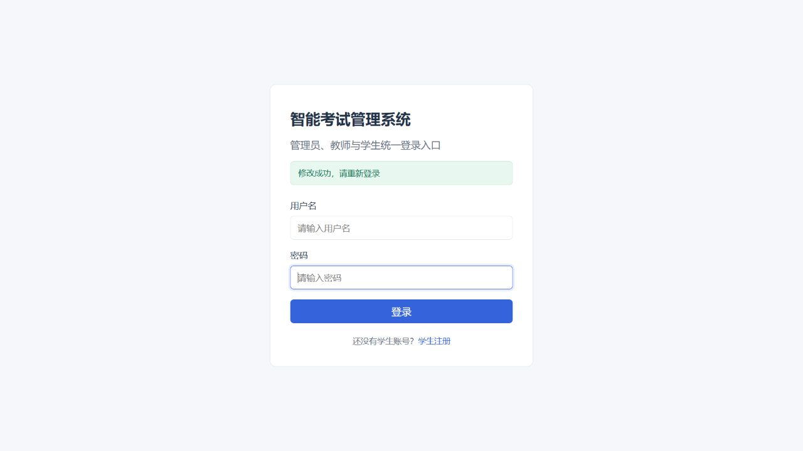
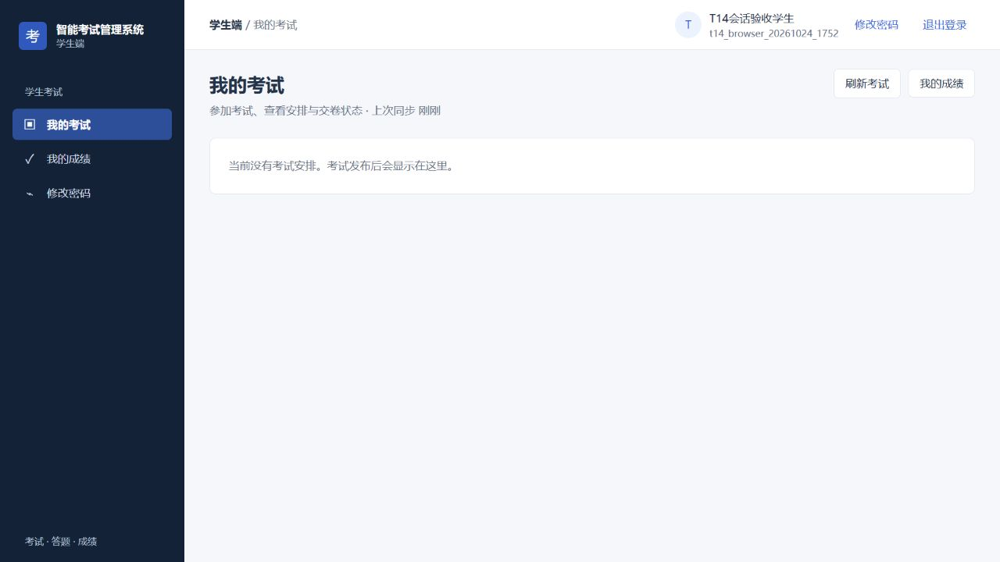

# B4A / T14：账号会话撤销

2026-10-24；基线 `bc084a3`；隔离分支 `codex/system-optimization`。对应同一提交的实现，未部署或迁移原业务库。

## 行为

- 新增 `users.token_version BIGINT NOT NULL DEFAULT 0`；新JWT携带 `tokenVersion`，每次认证与当前数据库版本比较。
- 缺少版本的历史JWT按0处理，仅在账号版本仍为0时接受，不延长原有效期；字符串、负数、小数、数组等不合法版本拒绝。
- 本人改密、教师课程学生重置、管理员教师重置、管理员学生重置，均将密码与版本递增放在同一条数据库更新中。重置只写密码相关字段，不覆盖并发停用状态。
- 教师/学生账号从启用变停用时递增版本；重复停用幂等，重新启用不恢复旧JWT。MySQL赋值按从左到右执行，因此先依据旧状态递增，再写新状态。
- 本人改密先持有账号行锁验证当前密码，再更新；成功响应形状不变，前端使当前会话过期，清空密码输入并要求重新登录，同一用户草稿归属保留。失败保留输入与当前会话；迟到响应不影响新登录身份。
- 保持既有重置权限及强制修改临时密码门槛，不新增账号管理权限。

## 验证

| 层次 | 结果 |
| --- | --- |
| 新后端安全测试 | 8项RED，原来旧Token仍200、无版本列；实现后8项GREEN |
| 真实独立连接并发 | 3项RED版本仍0 → GREEN：两次重置版本2、重复停用版本1、重置与停用版本2且仍停用 |
| 新前端行为 | 3项RED → 4项GREEN；编译真实改密组件处理器与实际登录组件SSR |
| 指定后端安全/生命周期 | 37/37，退出0；原有2处旧行为预期更新为401及重新登录 |
| 后端完整verify | 431/431，失败0、错误0、跳过0，BUILD SUCCESS，17:50:57 +08 |
| 前端完整测试及构建 | 143/143，退出0；Vite生产构建成功 |

现有MyBatis复合表无单列主键提示、前端混合导入提示保留。本批完整运行日志位于忽略的 `.runtime/optimization/t14-*.log`，不提交认证输出。

## 迁移与恢复

使用私有MySQL `127.0.0.1:13306`。先把19表合成测试库完整备份，再分别恢复到 `smart_exam_opt_t14_upgrade_20261024` 和 `smart_exam_opt_t14_restore_20261024`，比较全部表的SHOW CREATE、COUNT和CHECKSUM。

升级副本实际执行同一增量SQL两次：列只添加一次，旧用户全部版本0，已有用户字段指纹不变；恢复副本保持旧结构，19表结构、行数、校验和与备份恢复基线相符。备份SHA256 `4E16B990A03726EFD31D7B1A05065D851CDFD09E3AD04C45028F65560BE1A0EB`。备份、凭据、数据库文件均忽略且不提交。

续接后先查实际测试库缺列，再经受限账号和目标库guard只对测试库执行该迁移。没有重跑初始化或其他升级脚本。`sql/init.sql` 仅更新新建库结构，未执行其固定USE脚本。

旧代码可读取增加字段后的表，但**旧代码不会执行令牌版本检查**。回退代码并不保留撤销保障；正式回退须单独安排全量会话失效或保留此安全检查，不能只git回退或删列。当前没有执行密钥轮换、切换或部署。

## 实际HTTP与浏览器

隔离预览 `15173 → 18080 → 13306`，新注册合成学生7103。实际API改密前me200，改密200，旧JWT401、旧密码401、新密码登录200、新JWT200。

实际浏览器先以旧密码登录并打开改密页，随后API完成改密；原页面刷新要求重新认证。旧密码登录显示错误，新密码正常进入本人页面。管理员API执行停用、重复停用、重新启用均200；浏览器此前会话在重新启用后仍跳转登录，新登录正常。实际数据库核对最终启用、版本2。

浏览器没有输入新密码或提交改密表单；改密提交逻辑由真实编译组件处理器测试、实际HTTP与旧会话浏览器组合覆盖，**不称为完整改密表单E2E**。登录成功提示另由SSR与实际直接导航对应登录URL验证，不能当作表单提交证据。

## 独立审查与裁定

一位全新上下文审查者只读检查差异并独立执行新增前端4项：无Critical、无Important，1项Minor；没有二次审查。

**Deferred minors：** 改密已提交成功后，另一个旧Token请求先401并清空会话，成功响应随后到达时会被当作会话已变更，跳过“修改成功”提示和清输入。撤销保障有效，属于可恢复提示缺失，延期；未来应区分同会话过期与换用户并补响应顺序测试。T11/T12/T13已记录Minor继续保留。

**Rulings I made：**

- 把UsersMapper/UsersService、LoginView及新增集成/并发测试纳入本批：它们是原子写入边界、提示消费方及真实并发证明。若判断错误，扩大范围仅限共享账号写入和登录提示；所有已知账号入口及全套已覆盖。
- 复用 `expireSession` 保留同用户草稿归属，而非显式退出时删除草稿；代价是本地草稿继续遵循T08同用户恢复规则，不能据此宣告完整故障矩阵通过。
- 数据库加法与条件更新替代“读版本再整体覆盖实体”，防止并发丢失撤销或重新启用；旧账号状态语义与重置权限保持。

**审查者未裁定事项及本轮裁定：**

- T07旧保存响应和T07/T08跨用户恢复完整矩阵未重验；T14复用边界并通过迟到改密响应测试，B2故障矩阵仍OPEN。
- T03/T04历史选项和绑定归档恢复、T10纯客观及无人参考发布未完整重跑，仍是B5整体门槛。
- T01/T17原SQL隔离、旧脚本、历史主键及实际迁移恢复由作者验证；独立审查只检查本迁移的增量与相对当前库执行方式，不接触原环境。
- 审查者没有执行完整后端/前端、HTTP或浏览器；上述作者证据不能标为双人重复验收。
- 教师全局重置授权重设、身份核验、审计和成绩纠错依然是独立业务决策；本批不扩权。
- 已在撤销提交前完成认证的请求，不承诺被事务内强制取消；本批保证后续认证检查拒绝旧版本，不开展跨事务授权重构。
- 原环境发布及回退安全未实操；回退旧代码的撤销边界已明确列入发布/回退事项，不能声称单纯保留列便可保留保护。

## 保护与下一步

17:53:39 +08原项目复核：361/361文件SHA256一致，8处受保护路径元数据一致，原HEAD `59d1389f31b4931a533390aa684db94dba488e2e` 不变。原MySQL3306 PID77496保持，未进行原库业务操作或原服务启停。私有监听MySQL206476、后端207680、前端203820。

下一任务T15查询规模优化；B2剩余故障注入及B5整体验收仍未完成。未合并、推送、切换或部署。
