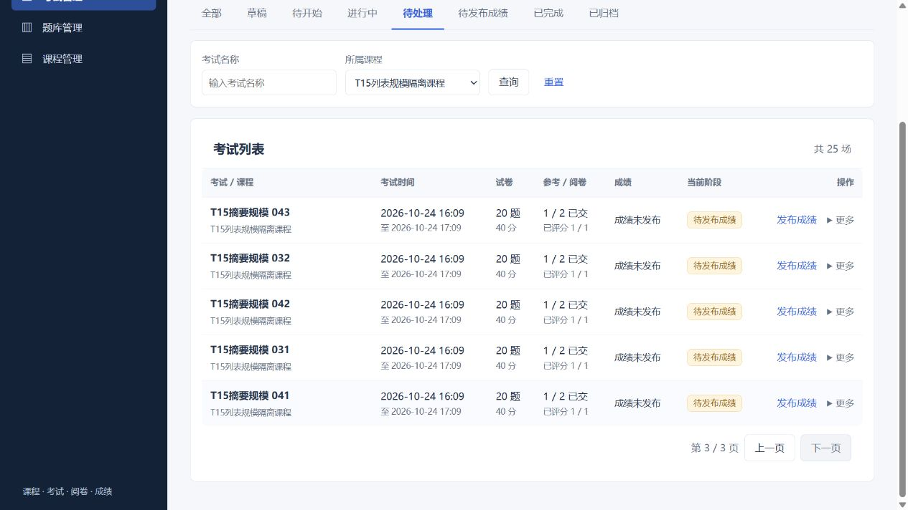

# B4A / T15：考试摘要查询规模

2026-10-24；基线 `1d10b61`；隔离分支 `codex/system-optimization`。对应同一提交实现，不代表生产容量或整体发布验收。

## 结果

教师考试中心先在SQL中按教师、课程、名称、归档和阶段筛选，再统计总数并按ID倒序分页。当前页才读取题数、总分、名单及评分汇总，不再把全部考试和试题全文读入Java后分页。

学生列表批量读取课程、本人答卷与试题计数/总分。初始已知进行中答卷仍沿用T06的考试→答卷锁和每场独立事务；先执行到期处理，再读取最终批量投影，避免重新引入跨考试锁等待。没有答卷或已交卷的场次不再逐场读取全文或加写锁。

保留请求、PageResponse、所有权、应考快照、未发布分数双重门控及旧排序。无前端行为、依赖或schema变更，无新增索引。学生接口仍返回原有全部可见摘要，长列表UI没有在本批改成分页。

## RED→GREEN及当前回归

首次测试探针使用MySQL26.7未提供的Rows_sent，发生2项探针错误；改用实际支持的Bytes_sent后，原代码出现2项目标失败，随后实施优化。指标通过测试事务内同一真实数据库连接的SHOW SESSION STATUS取得，未模拟SQL调用次数。

| 固定数据集 | 修改前 SELECT / 传输字节 / 单次耗时 | 修改后 SELECT / 传输字节 / 单次耗时 |
| --- | --- | --- |
| 教师40场、4000题，每页5场 | 7 / 3,774,297 / 42ms | 5 / 3,726 / 2ms |
| 学生30场、1200题，无进行中答卷 | 152 / 1,191,273 / 77ms | 4 / 13,706 / 6ms |

这是同规模自建事务数据、同私有MySQL实例上的单次对照，包含查询结果协议开销；不是HTTP载荷、压测、并发容量或生产吞吐量。完整verify复测为教师3727字节/2ms，学生13706字节/5ms，微小差异不作性能承诺。

- 目标回归23项通过，含11项真实独立事务并发、6项学生生命周期、4项既有考试中心、2项新分页/规模测试。
- 新分页测试涵盖九阶段、TODO跨页、COMPLETED包含无人参加、越界空页总数、归档及其他教师隔离；小样本列表与既有详情阶段对照。
- 后端完整 `verify`：434/434，失败0、错误0、跳过0，18:06:43 +08 BUILD SUCCESS。
- 前端143/143，生产构建成功，均退出0。保留既有MyBatis主键和混合导入提示。

日志与指标位于忽略的 `.runtime/optimization/t15-*.log`，不会提交敏感运行输出。

## EXPLAIN与索引裁定

用仅针对新测试的JdbcTemplate DEBUG捕获实际prepared SQL，不启用参数TRACE；据此对私有库实际执行四类EXPLAIN：基础ID分页、阶段总数、当前页摘要、当前页生命周期计数。替换参数选择现有隔离教师数据，页事实使用持久化考试4223；这不是4000题测试事务的执行计划压测。

当前计划使用PRIMARY、`uk_submissions_exam_student`、`uk_answers_submission_question`、按考试关联的题目/考生索引和课程学生唯一索引。页聚合与生命周期聚合存在派生临时表；阶段过滤仍必须读取匹配考试的最小评分事实。未发现需要本批新增索引的证据，保持schema。MySQL新版JSON计划字段为index_name/estimated_rows，摘要工具已按实际格式解析；完整计划存私有JSON。

## 实际HTTP与浏览器

自建课程5812：65场考试、1300题，其中60场未归档、5场归档；25场已交客观题答卷待发布、10场无人交卷。准备的是合成生命周期数据，没有伪造成绩发布时间或开展真实模型调用。

- HTTP原分页契约：未归档总60，size20第三页20；TODO总25、第二页5；COMPLETED总10；归档总5。
- 学生HTTP中该课程35场，每场20题、满分40，未发布totalScore全部null，响应没有题目全文。
- 浏览器保持原UI每页10条：待处理25场/3页，第三页5条，实际刷新保留课程、筛选和页码。已完成显示10场无人参加，已归档5条。
- 学生实际页面该课程35场显示正常，没有题目全文或未公布分数。

## 独立审查与决策

一位全新上下文审查者只读静态审查本批，没有执行后端、迁移或原环境操作；无Critical、无Important，没有二次审查。

**Deferred minors：**

1. 首次入场事务在初始active查询时尚未提交，截止后提交且最终摘要已看见它，本次列表可能短暂显示过期IN_PROGRESS；后续列表、答卷读写和scheduler收敛，硬截止写入保护保留。需补真实首次入场跨截止回归，再考虑只对最终投影中新发现的已到期进行中行执行加锁处理。
2. 普通草稿取课程有效名单、补考草稿取专属快照，SQL分支静态正确，但新增测试没有直接对两者完整字段做列表/详情一致性断言，作为覆盖建议延期。

既有T11—T14的Minor继续登记，没有借本批扩展修复。

**Rulings I made：**

- 阶段筛选必须先于LIMIT，因此需要在SQL中聚合全部匹配考试的最小评分事实；仅当前页做展示元数据聚合，不加载全文实体。代价是阶段计数仍随匹配场次数增长，不能宣称常量数据库计算量。
- 在共享生命周期仓库提取closed/pending/incomplete片段，同时把考生计数限定到请求ID，避免阶段SQL和已有判断对缺失答案/客观评分分歧。代价是共享读取路径变化，完整回归已检查。
- 学生只有初始已知进行中答卷保留写事务；其余使用最终批量摘要，不承诺列表全场原子快照。代价包括上述首次入场交错Minor，必须在后续报告保留，不能以性能数字掩盖。
- 使用Bytes_sent实际传输对照而非缺失的Rows_sent或模拟调用断言；仅判断消除了全文传输，不外推生产性能。

**审查者未裁定事项及本轮裁定：**

- T07保存响应及T07/T08换用户恢复未重验，本批不改前端或保存协议，B2故障矩阵仍OPEN。
- T03选项及T04绑定归档恢复未重验，列表只读，不重写历史；完整闭环仍属B5。
- 固定USE、迁移部分成功、原库保护由作者既有隔离边界及本次新鲜复核记录；本批无迁移，也未运行原初始化SQL。
- 全套、RED/GREEN、Bytes_sent、EXPLAIN、HTTP、浏览器由作者执行，不标为审查者重复复现。
- 生产吞吐、并发容量、未来是否需要新增索引没有证明；当前测量只支持本批摘要路径优化。
- 学生调用方自行增加外层事务的传播未改，REQUIRED仍可加入现有事务；生产列表入口没有整体事务，不扩展任意外部调用保证。
- 全局时区部署及违反NOT NULL的数据没有验证；当前库约束已核对，阶段计算仍使用既有时钟。
- B4B权限重设与B5全故障矩阵未进入本批，保持独立记录。

## 环境及下一步

本批最终再次运行原环境保护脚本：361/361文件SHA256及8处受保护路径元数据一致，原HEAD仍 `59d1389f31b4931a533390aa684db94dba488e2e`，原3306 PID77496。只替换隔离预览，当前后端202788、前端200580、私有MySQL206476。

未合并、推送、部署或操作原业务库。下一步T17/B5整体矩阵及发布候选，先补B2剩余故障注入；T16权限、身份、审计、纠错仍需独立业务设计，不混入当前实现。
