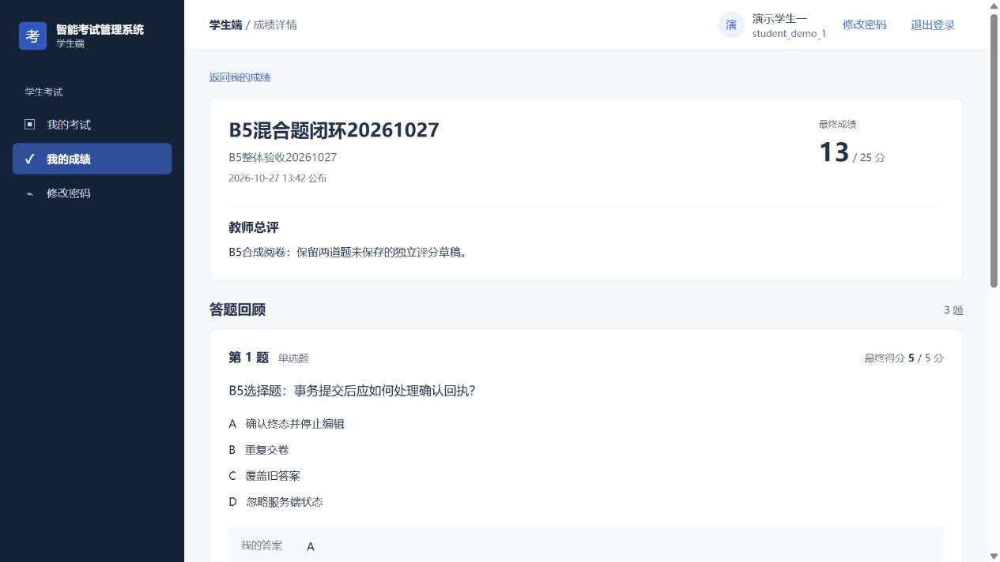
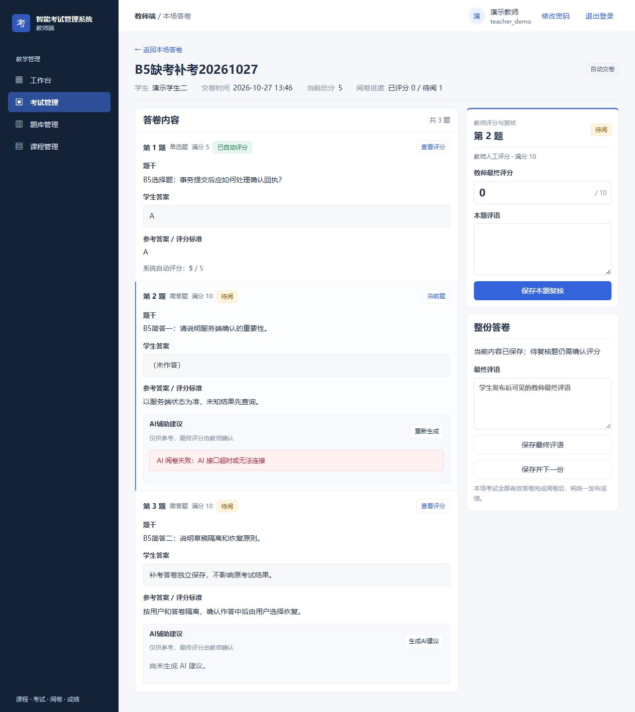

# B5 业务闭环补验与阅卷题序修复

日期：2026-10-27（北京时间）。代码基线为 `6e9858f`，本批新增阅卷题序修复；最终提交见 Git 历史和阶段包 manifest。

**本批已完成下列验证，T17 整体验收仍在进行中，完整发布结论保持 `NOT_PASSED`。** 不合并、不推送、不部署，不操作原业务库，不扩展 B4B。

## 环境与证据边界

- 独立分支 `codex/system-optimization`；测试库 `smart_exam_opt_test_20261019`，自有 MySQL 13306、后端 18080、前端 15173，均限本机。
- 13:34—13:38 的建课、出题、发布、作答和阅卷在同一代码基线的 Vite 开发预览完成。随后切换到生成的 `frontend/dist`，后续出分、补考、复制、归档恢复、导入与组卷使用生产前端产物。不能把最初的开发预览写成生产产物验收。
- 题序修复后重新完整打包、恢复普通 AI 未配置的隔离预览，并复验实际补考答卷及接口。最终 JAR SHA256：`829ECE86B2802123D2866A2FEE500B7579A546A99246C5DC960557D187AFCE70`；前端入口 `index-CUcS5w4G.js`。
- 浏览器操作、真实 HTTP、MockMvc/逻辑测试和模型替身分别记证据。恢复演练仅涉及私有合成库。

## 实际业务闭环

| 场景 | 本次实际结果 |
| --- | --- |
| 教师建课、出题与发布 | 页面创建课程 6631、考试 6233，加入两名演示学生，手动配置三题共 25 分并通过发布检查 |
| 学生保存与交卷 | 学生一进入答卷 3724，三题自动保存；正常刷新读回服务端答案；有修改时离开提醒可取消；确认交卷前保存最新修订，教师读到最终答案 |
| 阅卷草稿和明确零分 | 两道简答题草稿在保存总评、切换题目和保存另一题后仍保留；明确复核 0 分和 8 分，加客观题 5 分，共 13 分；“保存并下一份”返回全部阅完 |
| 自然截止、缺考和出分 | 等待 13:42 自然结束，统计为一人参加、一人缺考；整场出分后学生看到 13/25、逐题 5/0/8、两层教师评语；教师输入只读，接口改分返回 409，原分数不变 |
| 补考隔离与自动交卷 | 页面建立补考 6597，只选缺考学生二，另一个学生看不到且入场返回 404；学生二答卷 3912 在 13:46 自然截止后显示自动交卷，晚写和重复交卷均 409，原考试结果不变 |
| 复制与归档恢复 | 页面复制为草稿 6598，题目 ID 独立，无答卷或已发布成绩；归档、已归档列表和恢复均实际操作，主考试原答卷和 13 分成绩保留 |
| 权限 | 学生二读取学生一成绩返回 404；学生和管理员访问教师接口均 403；管理员页面访问教师路由回到管理员概览 |
| Excel 导入 | 从当前页面下载模板，用合成样例导入三题、两评分点；预览三题有效、零错误；重复预览检出三条重复，显式选“跳过”后导入零、跳过三，题库 2516 仍为三题 |
| 三种题库组卷 | 在复制草稿中手动选一题、随机预览确认一简答、规则诊断并预览确认一困难单选，最后六题 45 分；评分点仍为两项共 10 分 |

最终接口复查共 13 组，保存于[脱敏 HTTP 记录](evidence/2026-10-27-b5-final-http.json)。其中题序、分数和评语归属在修复后的最终 JAR 上再次核对。完整点击流程没有因修复重新从建课执行一遍。

## 本批发现并修复的缺陷：阅卷题序

学生先保存第 1、3 题，第 2 题留空时，空答案记录在交卷时才补建。旧查询按答案记录 ID 返回，导致教师页面把第 3 题显示为第 2 题，而空白第 2 题移到第 3 题。学生试卷和成绩使用的是 `questions.sort_order, questions.id`。

只修改 `AnswersMapper.selectBySubmissionId` 的读取排序：通过题目主键关联，按试卷排序号和题目 ID 排序，继续返回 `a.*`。不修改答案、分数、评语、表结构或历史数据。

新增真实接口集成回归 `gradingPaperKeepsExamOrderWhenAnswersWereSavedOutOfOrder`，覆盖逆序保存、提交补建空答案、排序号与题目 ID 不一致、相同排序号按 ID 排列，并核对完整题目 ID 和答案内容序列。

- RED：13 项中该新增用例按预期失败，实际顺序与独立给定的题序不同，退出 1。
- GREEN：同组 13/13，退出 0；随后完整后端 435/435，失败、错误、跳过均为 0，14:00:36 `BUILD SUCCESS`，退出 0。
- 最终生产预览复验同一答卷 3912：第 2 题恢复为空白的“服务端确认”，第 3 题恢复为已答的“草稿隔离”；原总分仍为 5，主考试正式成绩仍为 13。
- 实际私有库存在对应外键、孤立答案数为 0、外键检查启用。EXPLAIN 使用答卷/题目唯一索引及题目主键，处理本答卷三行；不是容量或生产压测。

## 可控 AI 验证

临时替身只绑定 `127.0.0.1:18083`，后端指向固定本机地址和合成配置。没有真实模型调用、费用或外部转发；不记录原始提示、答案、认证头或令牌。

- 意图解析分别返回合法固定 JSON、HTTP 503，以及延迟 35 秒的响应（超过后端 30 秒时限）。成功后仍需教师确认再编辑规则；失败/超时清除旧理解、保留原输入，可以切换到规则编辑。
- AI 阅卷分别返回固定建议 8 分、503、35 秒延迟。固定建议仅用于验证状态与建议/正式分数分离，不评价模型质量。失败和超时后旧建议分与理由清除；正式总分仍为客观题 5 分，人工复核没有被替代。
- 六次替身请求的类型与模式见[脱敏计数](evidence/2026-10-27-b5-ai-stub.json)。该计数是服务端替身证据，不等同于浏览器网络抓包。
- 以上 AI 页面场景在题序修复前执行；修复后接口再次确认失败字段已清除。没有重跑完整 AI 解释、排序推荐和确认入卷链路，因此该完整链路仍不标为最终全矩阵通过。

临时替身已经停止，普通隔离应用恢复 AI 未配置状态。没有修改仓库配置或原环境。

## 恢复演练与自动化

三处新建、明确命名的私有验证库分别验证当前合成库备份恢复、旧结构恢复，以及升级后实际从旧备份恢复。每组 19 张表，结构、行数与扩展校验和一致；迁移连续执行两次，旧用户字段保持一致。只在新建的可丢弃演练库恢复，原测试库和原业务库没有被覆盖。见[恢复记录](evidence/2026-10-27-b5-recovery.json)。

数据库恢复已实际验证，旧版应用运行回退尚未执行；旧代码缺少会话版本校验，不将其称为安全上线回退方案。

| 本日检查 | 实际结果 |
| --- | --- |
| 修复后完整后端 verify | 435/435，失败 0、错误 0、跳过 0，退出 0 |
| 未改动的前端全套 | 148/148，退出 0 |
| 前端生产构建 | 退出 0；后续使用 dist 预览 |
| 学生兼容 CLI | 60/60，退出 0；逻辑/编译处理器验证，不是浏览器 E2E |
| 管理员结构脚本 | PASS，退出 0 |
| 数据库隔离检查 | 三种场景 PASS，退出 0 |

## 独立审查与裁定

对本次两个代码/测试文件进行一次独立只读审查，无 Critical、Important 或 Minor；没有要求二次复审。审查者检查了查询、所有生产调用方、约束定义、回归用例和 `git diff --check`，未修改工作树。

审查者未裁定的事项及本批裁定：

1. RED/GREEN 和全量测试没有独立重跑：采用作者本日实际输出，不写成双人重复验证；若运行证据不足，不能据此放行。
2. 运行库约束和性能未由审查者核实：作者补查私有库外键、孤立行和 EXPLAIN，只支持该库与该样本；生产结构和容量仍需另验。
3. 浏览器未由审查者复验：作者在最终 JAR 重新核对 3912 的题序及答案；不扩展为全系统页面通过。
4. 此前 24 个提交和范围外问题未审查：本次结论只覆盖题序修复；整个 B5 发布门槛继续保留。

## 保留的缺口与轻微问题

- 浏览器禁用/耗尽会话存储、脏状态硬刷新/关闭原生提醒、墙钟偏移、真实隐藏/恢复与 offline/online 事件路径仍缺完整真实环境验证。
- 本次视口能力的 `set` 调用返回后，实际 `innerWidth` 仍为 1280、`innerHeight` 为 720。没有把重复的 1280 截图称为四种宽度通过；其他宽度及全页面状态矩阵继续 OPEN。
- 组卷的 E/自定义标识、所有导入边界、跨教师页面负例和完整 AI 推荐确认链路，仍缺最终同一产物下的全量浏览器矩阵；后端回归与旧页面证据分别保留。
- 本次新观察的 Minor：离开提醒打开后自动保存完成，弹窗可仍显示“0 题修改尚未保存”；考试未结束但已全阅时部分提示仍称有未阅答卷；AI 错误文案重复提示可切换规则。未扩展修复这些提示问题。
- 原有延期 Minor 继续见[整体验收进度](2026-10-19-optimization-acceptance.md#deferred-minors)，本批没有重开。

本批裁定：复用原账本和隔离库避免丢失续接证据；用 dist 明确区分开发预览和产物验证；只记录真实尺寸，不注入页面替身伪造环境；模型只接本机受控服务；题序从读取源头修复而不重编号或改历史分数。若把这些边界误写成完整验收，会放行仍未覆盖的环境路径，因此整体结论仍为 `NOT_PASSED`。

## 原环境与归档

14:04:52重新核对原361个文件 SHA256、8处受保护路径元数据和原HEAD `59d1389f31b4931a533390aa684db94dba488e2e`，均与基线一致；原3306仍为PID77496。隔离后端健康UP、生产前端HTTP200，临时18081/18083均无监听。

源代码、回归、脱敏记录和页面证据按明确路径归档为可回退的本地提交，阶段包继续标记 `NOT_PASSED`、无部署授权。包只包含生产JAR、dist、单个迁移、报告和哈希manifest，截图及脱敏记录在同一提交的源码中查看，不包含凭据、数据库、测试备份或运行日志。最终提交和包哈希以Git及忽略目录中的本批manifest为准。

隔离工作区、库、预览和证据保留供下一批续验，T17不标为完成。
